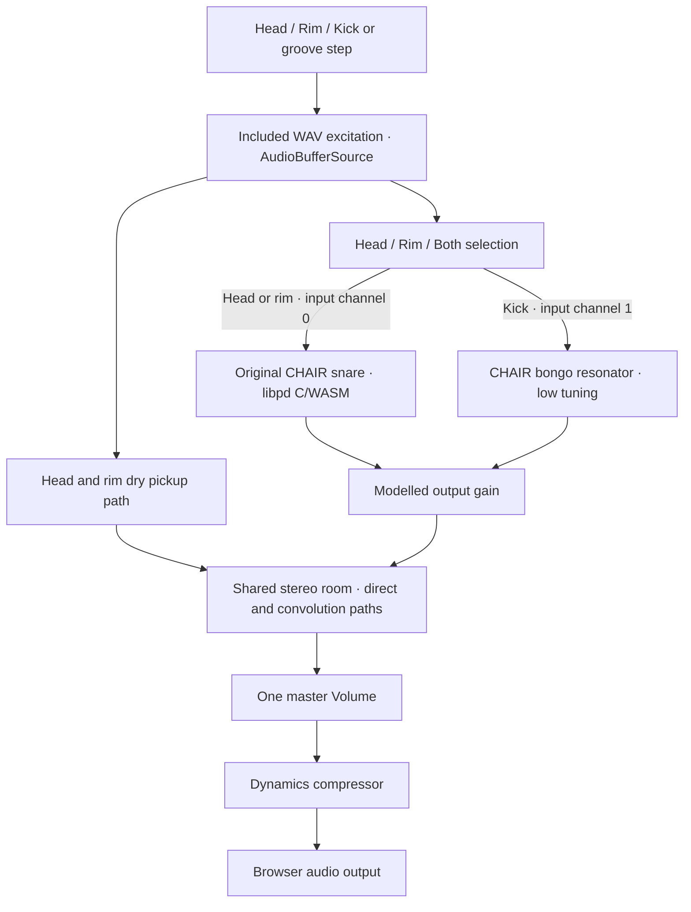

# Architecture

The repository preserves three related things: the original instrument and hardware patches; a portable Pure Data audition; and the browser audition. The browser uses included microphone excitations and manual Head/Rim/Both selection. The recovered hardware patches retain Bonk training and the live sensor design.

## Browser audio

`app.js` owns the AudioContext and audio graph. The requested sample rate is 44.1kHz. `libpd-engine/engine.js` loads the exact Pd files, creates the worklet and sends parameter messages. The pinned worklet runs two 64-sample Pd DSP ticks for each 128-frame Web Audio quantum. Original model provenance and numerical comparisons live beside that adapter.

The kick is a later demonstration voice. It uses a separate input channel and shares the same room with the snare and dry pickups. `room-reverb.js` builds a deterministic stereo impulse with a 0.82-second buffer, early reflections and a decaying filtered tail. A direct path and a predelayed convolution path feed the master output.

## Controls and timing

`state` in `app.js` holds sensing mode, baseline tuning/rattle/damping, velocity, mix and latch pull. The resting model values are tuning `.6`, rattle `.8`, damping `.6`. Pull changes rattle to `.8 × (1 − pull)`. The largest active pull from the held key, 3D latch, global percentage or current sequencer automation wins. This preserves a held latch while the groove changes its own automation.

`sequencer.js` edits the events for each preset. The 32 columns span eight beats. `app.js` schedules audio against AudioContext time with a 25ms polling interval and a 120ms lookahead; visual highlights use timers. Hit cells toggle kick/head/rim events. Percentage cells add per-step latch automation. Preset edits stay in the current browser session.

`scene.js` loads the supplied GLB, applies `materials.js`, sets the fixed view and shadows, and translates playing gestures into `messier:strike-input`, `messier:latch-input` and switch events. The same state events update the scene and controls. CAD is retained separately in `hardware/cad/`; the presentation model remains in `visualisation/`.

## Start and close

The embedded player asks for an audio choice. **Enable audio** constructs and resumes the graph from the visitor’s click. **Continue without audio** opens the controls and fixed model. The Audio button can enable sound later.

The portfolio creates the iframe when its instrument button is pressed. On close it replaces the iframe with `about:blank` and restores focus to that button. The player’s `pagehide` handler stops scheduled events and voices, disconnects the worklet and closes its AudioContext. Escape sends a same-origin close request to the parent. The containing portfolio verifies both message origin and source frame.

The standalone local entry uses the same player. Closing its tab tears down the graph. Its parent message is only meaningful when an embedding page handles that request.

## Historical hardware

The central lavalier supplies head excitation. The edge contact microphone supports playing-area classification. The selector chooses head, rim or both for one physical snare model. A short internal spring returns the brass shaft and fork. The original Bonk patches and training templates retain the hardware experiments; the portable auditions use manual selection and included excitations.

The build notes and BOM distinguish known evidence from measurements still to recover. The mahogany interior presentation image belongs to the portfolio; it is separate from the original sapele shell and the native Rhino design.

## Source reference

[Function index](functions.md) links the named original browser functions to their source lines. [The agent skill](../skills/messier57-instrument/SKILL.md) gives a task-oriented entry into these modules. [Third-party notices](../THIRD-PARTY.md) record dependencies, the verified CHAIR MIT source grant and bounded derivative provenance.

[made by atelier neyra](https://atelierneyra.com)
